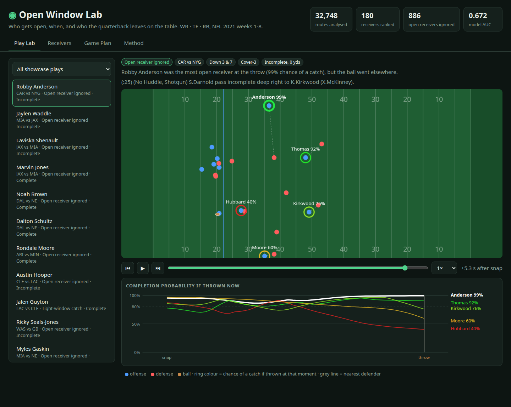
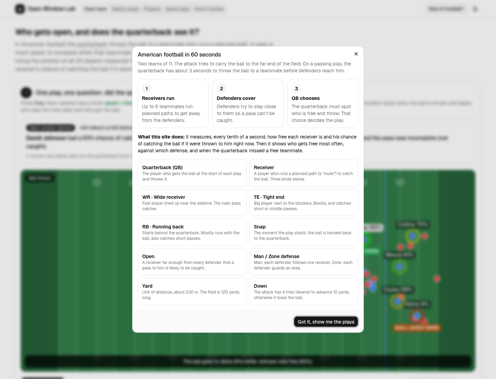
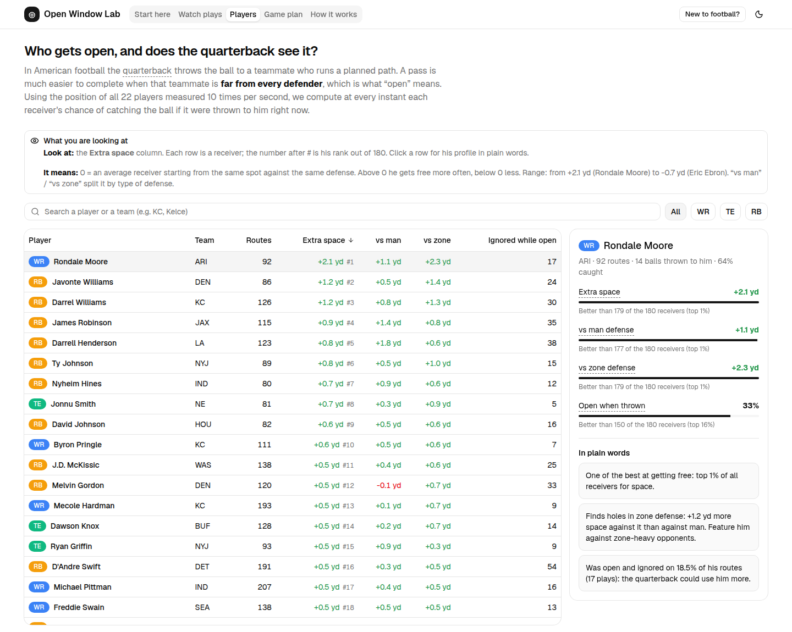
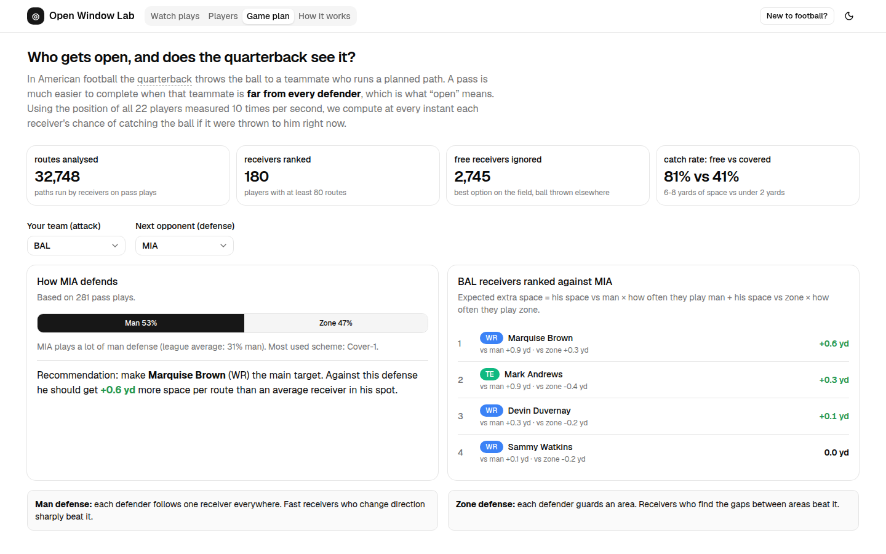

# Open Window Lab

**Who gets open, when, and which open receivers the quarterback leaves on the table (WR · TE · RB).**

We built a model that reads the NFL tracking data frame by frame and gives every route runner (WR, TE, RB) a live *"chance of a catch if the ball were thrown to him right now"*, plus two metrics on top of it: **Separation Over Expected** (space at the throw compared with receivers lined up in the same spot against the same coverage) and **Ignored Open** (the receiver was the best option on the field at the throw, and the ball went elsewhere: 2,745 times in 8 weeks). The data backs it up: targeted receivers with under 2 yards of space are caught 41% of the time, against 81% with 6-8 yards. It also shows that receivers do not get open against every coverage in the same way: TE Mark Andrews gets +0.92 yds vs man but −0.38 vs zone, and WR Rondale Moore is the most open receiver in the league (+2.1 yds). A **coach** uses the Game plan tab to pick who to feature against next week's defense, a **scout** uses the Players tab to rank players independently of their quarterback, and a **broadcaster** uses the Watch plays replays to show the open man the quarterback missed.



---

## How to launch

One command (Linux / macOS). Requirements: **python3 ≥ 3.10**, **git**, **Node.js ≥ 18**.

```bash
./run.sh
```

It will:

1. create a Python virtual env in `.venv/` and install `requirements.txt` (pandas, numpy, scikit-learn);
2. download the dataset into `raw_data/` (~1 GB, first run only);
3. run the analysis pipeline (~35 s), which writes `web/public/data/data.json` and `outputs/leaderboard.csv`;
4. install and build the web app (`web/`, React + Tailwind CSS + shadcn/ui);
5. serve it on **http://localhost:8000** and open it in your browser.

| Option | Effect |
|---|---|
| `./run.sh --no-build` | skip Python, the download and the analysis; reuse the committed `web/public/data/data.json` (only Node.js needed) |
| `PORT=9000 ./run.sh` | serve on another port |
| `NO_BROWSER=1 ./run.sh` | do not open the browser automatically |
| `.venv/bin/python -m pipeline` | run only the analysis |
| `npm --prefix web run dev` | web app in development mode (hot reload) |
| `http://localhost:8000/?help=0` | open the app without the automatic help dialog |

The built site (`web/dist/`) is static, so it can also be hosted as is (for example on GitHub Pages).

---

## What is in the app

New to football? The app opens with a one-minute explanation and a glossary, every tab starts with a "What you are looking at" box (what to look at, what it means), and every technical word has a tooltip.

| Tab | For | What it shows |
|---|---|---|
| **Start here** | everyone | Guided page in 3 steps: one annotated example play (the animation stops at the throw and labels the most open receiver and the one who got the ball), why space matters (catch rate chart), and the top 10 receivers by extra space. |
| **Watch plays** | broadcaster | 90 showcase plays replayed on a field (smooth 60 fps animation, positions interpolated between the 10 Hz tracking frames). Each receiver has a ring coloured by his live catch probability, a dashed line to his nearest defender, and a chart of the probability of every receiver from snap to throw. Three categories: *Open receiver ignored*, *Wide-open catch*, *Tight-window catch*. |
| **Players** | scout | Sortable, searchable table of 180 receivers (≥ 80 routes): extra space, vs man, vs zone, open when thrown, ignored while open. Clicking a player opens a profile with percentiles, a plain-language verdict ("beats man defense", "finds holes in zone") and a button to watch his plays. |
| **Compare** | scout, coach | Two receivers side by side: every metric with its rank among all receivers, a plain-language verdict, the share of man defense at which the better choice switches from one to the other (and which of the 32 defenses fall on each side), and a man-vs-zone map of all receivers. Open it from a player profile (“Compare with another receiver”) or by link (`#compare`). |
| **Game plan** | coach | Pick your team and the next opponent. The opponent's man/zone mix is weighted against each of your receivers' space vs man and vs zone to rank who to feature. |
| **How it works** | everyone | Validation chart (catch rate vs space), model calibration chart, definitions and limits. |





---

## Method

1. **Normalisation**: every play is flipped so the offense attacks to the right (`playDirection`).
2. **Per-frame features** for each route runner (PFF role `Pass Route`) from snap to throw: distance to the nearest defender, how fast that gap is closing, speed, depth past the line of scrimmage, distance to the quarterback, distance to the sideline, time since snap.
3. **Target**: the tracking does not name the targeted receiver (and stops 0.5 s after the throw), so we read the receiver's name in the official play text (`pass short right to C.Godwin`): 7,287 passes identified.
4. **Model**: logistic regression and gradient boosting are compared with 5-fold cross-validation on targeted throws (C vs I/IN). The best one (gradient boosting, AUC 0.75) is then applied to **every frame of every route**, which gives the live probability.
5. **Metrics**
   - *Separation Over Expected* (“extra space”): space at the throw minus the mean of the same PFF alignment (e.g. `SLWR`, `TE-L`, `HB`) against the same coverage type (man / zone).
   - *Open when thrown*: share of routes with a catch probability ≥ 80% at the throw.
   - *Ignored while open*: the receiver had the highest probability on the play, ≥ 80%, and someone else was targeted.
   - *Game plan score*: `man_rate × SOE_man + (1 − man_rate) × SOE_zone`.

**Limits**: only weeks 1-8 of 2021; the target comes from the play text (a few plays with unusual names are skipped); the model only knows positions and speeds (no pressure on the QB, no ball placement); probabilities before the throw are an extrapolation of a model trained at the throw; running backs get easy space on check-downs, which is why SOE compares them only to other backfield alignments.

---

## Project structure

```
run.sh                     one command: setup, download, analysis, build, serve
requirements.txt           Python dependencies
pipeline/                  Python analysis (python -m pipeline)
  config.py                paths and constants (thresholds, event names)
  loading.py               read the csv files
  geometry.py              field orientation, key frames, nearest defender
  features.py              per-frame features of every route runner
  targets.py               targeted receiver read from the play description
  model.py                 completion probability model (train, compare, predict)
  metrics.py               route, player and team metrics, validation tables
  replays.py               pick showcase plays and extract their tracking
  export.py                write web/public/data/data.json
  __main__.py              runs the steps in order
web/                       web app: Vite + React + TypeScript + Tailwind CSS + shadcn/ui
  public/data/data.json    generated by the pipeline (committed)
  src/
    App.tsx                layout, header, tabs
    types.ts               shape of data.json
    components/ui/         shadcn/ui components (generated by the shadcn CLI)
    components/            HelpDialog, Kpis, Term (tooltip), PositionBadge
    features/plays/        Watch plays: PlaysTab, FieldCanvas, Timeline, PlayList, PlayStory, HowToRead
    features/players/      Players: PlayersTab, PlayersTable, PlayerProfile, columns
    features/compare/      Compare: CompareTab, HeadToHead, MatchupChart, ManZoneChart, duel (verdict maths)
    features/plan/         Game plan
    features/method/       How it works (shadcn charts)
    hooks/                 useAppData, usePlayback (smooth animation), useTheme
    lib/field.ts           canvas drawing of the field and players
    lib/format.ts          formatting and small helpers
    lib/plan.ts            game plan formula, shared by Game plan and Compare
  src/index.css            shadcn theme (paste any theme from ui.shadcn.com/themes to restyle)
outputs/
  leaderboard.csv          full receiver table
  screenshots/             images of the app
```

Data: [NFL Big Data Bowl regional event data](https://github.com/ThompsonJamesBliss/nfl-big-data-bowl-regional-event-data) (NFL Next Gen Stats tracking + PFF scouting, 2021 weeks 1-8).
