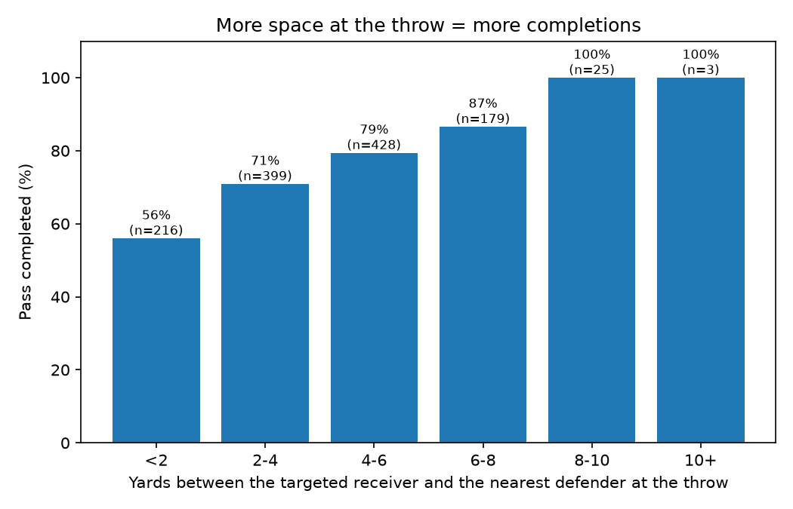
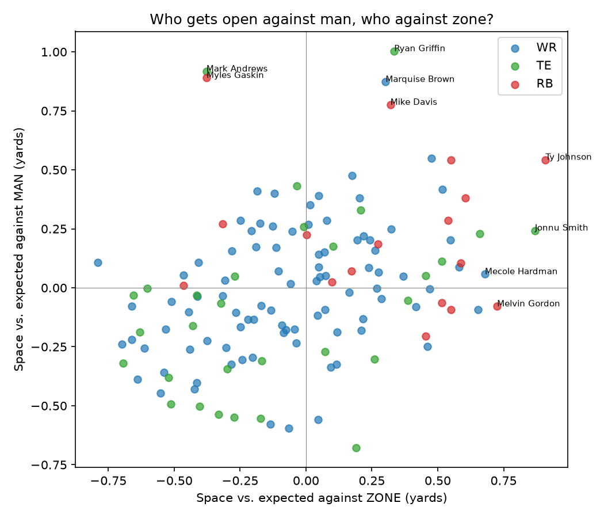
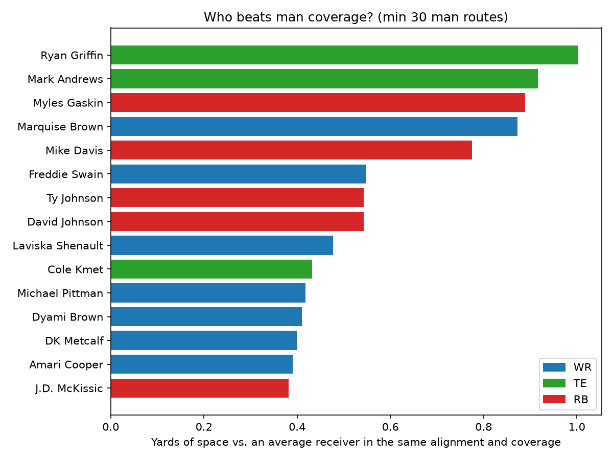

# Separation Over Expected (SOE): who really gets open?

We measure, for every WR/TE/RB pass route (32,848 routes, weeks 1-8), the distance to the nearest defender at the moment the ball is thrown, then subtract what an average receiver gets from the same alignment against the same coverage (man or zone, PFF labels), giving Separation Over Expected in yards. The metric is validated by the data: when the targeted receiver has under 2 yards of space 56% of passes are completed, versus 87% at 6-8 yards. It shows that receivers are not equally good against both coverages, for example TE Mark Andrews is +0.92 yds against man but -0.38 against zone, and WR Rondale Moore is the most open receiver overall (+2.09). Coaches can use it to design matchups (who to put in motion or isolate against man), and scouts to rank receivers independently of the quarterback. Limits: 8 weeks only, the target is inferred as the route runner closest to the ball at the end of the play, RBs benefit from check-down routes, and nearest defender ignores defender role.

**How to run:** clone the data with `git clone https://github.com/ThompsonJamesBliss/nfl-big-data-bowl-regional-event-data.git raw_data`, then `pip install -r requirements.txt && python main.py` (about 15 seconds). Results are written to `outputs/`.

